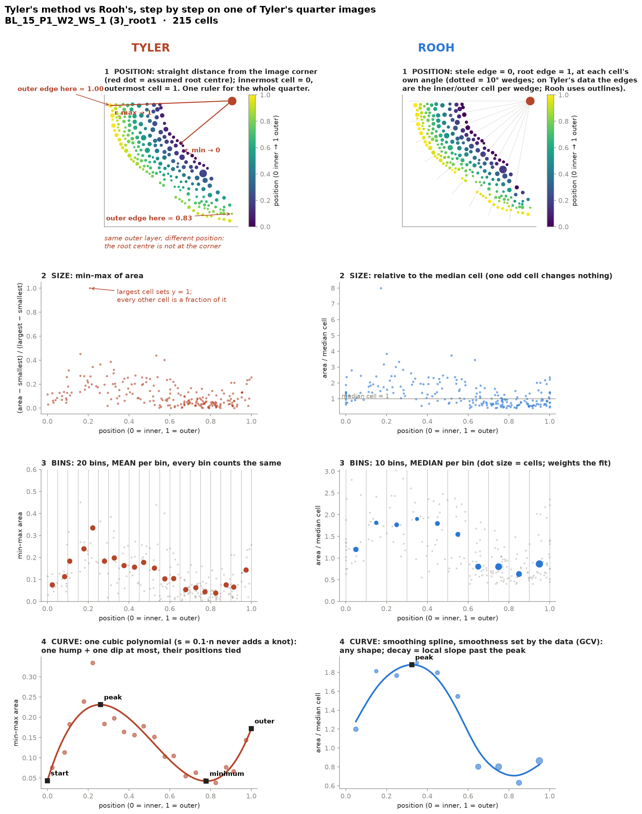

# Rooh development protocols

This log records the design decisions behind Rooh's measurements: what changed, why, and what evidence supports it. It runs in date order, oldest first; add new entries at the bottom. It covers how numbers are defined. UI changes appear only where they change what gets measured. The current rules live in the main README, under "Rules baked in". This log is how they got there. Where an entry has a figure, the script that draws it sits next to it.

Rooh started on 2026-10-27 as `cross_section_anatomy`, was briefly renamed JadNaksha, and has been Rooh (ਰੂਹ) since 2026-10-31.

---

## 2026-10-27 · Segmentation: Cellpose proposes, a person corrects
- **Decision:** Cellpose finds the cells. The root, stele and metaxylem are derived from them, and the cortical layers from those. A person corrects everything by clicking in the review app, and the automatic pass is only ever a proposal.
- **Tissue definitions:**
  - Stele = everything inside the outer edge of the endodermis.
  - Epidermis = cells within 6 px of the root outline.
  - Cortex = everything between the two, which includes the hypodermis.
  - Metaxylem = lumens in the stele larger than 5× the median stele cell, with solidity > 0.85.
  - Air spaces are their own class: counted, but never treated as cells.
- **Drawing rule:** each pixel has one owner. A drawn object takes any overlap, and a neighbour left with less than 25% of its area is removed. A drawn vessel merges with any vessel it touches.
- **Why:** nothing is counted twice, and no slivers survive to pass as small cells.
- Commits: 86bf10c, a7d88ac, dd887bf, 3fb843c, 14a403c.

## 2026-10-27 · Scale always comes from the user
- **Decision:** µm/px is set per image in `anatomy/samples.xlsx`. Scale bars are not read. Images with no scale stay in px and are listed in a warning.
- **Why:** bar detection misread tissue as scale bars, and many images have no bar at all.
- **Values:** Ortiz images are 0.7194 µm/px for maize and 0.3584 for Setaria.
- **Check (2026-11-02):** the px → µm conversion was confirmed end to end on R1. Area scales by (µm/px)².
- Commits: d35247d, 825a931, e6a5f4a.

## 2026-10-27 · Cortex pattern v1: spokes (one cell file per quarter)
- **Decision:**
  - The section is split into quarters Q1–Q4 around the stele centre.
  - In each quarter, one path of cells from the stele to the epidermis (a "spoke") gave cell size by file position.
  - The pattern curve and features came from those cells.
- **Damage:** a damaged quarter could be dropped. The centre always follows the traced stele; it is never placed by hand.
- **Unit:** quarters are sub-samples, so results are reported per image and per plant, never per quarter.
- **Superseded on 2026-11-02 by sectors** (below).
- Commits: a7d88ac, 69c701e, c82d63a, 67fb0ab, cd35eee, 8e3a327, 9635b22, 67475a2.

## 2026-10-30 · Brightfield images are inverted
- **Decision:** images with dark walls on a bright field (e.g. colour JPGs) are inverted to bright walls, and their black frame is blanked before segmentation. Fluorescence and DAPI images are unchanged.
- **Why:** on Amool's JPGs the root outline took the whole bright field (7.28 M px) as the root; after inversion the root is 2.6–4.4 M px.
- **Still open:** the automatic stele on brightfield images. Draw it by hand for now.
- Commit: 64fcd99.

## 2026-10-30 · The root outline is editable
- **Decision:** the root outline became an editing target, like the stele.
- **Why:** before this the automatic root outline could not be corrected, and it sets the epidermis and the outer edge for r_norm.
- Commit: ffc44c3.

## 2026-10-30 · Agreement statistics for auto vs reviewed results
- **Decision:** `compare.py` compares two result workbooks of the same images (auto vs reviewed, or reviewer vs reviewer). It reports per trait:
  - the number of images that changed,
  - Bland–Altman limits,
  - the mean |%| difference,
  - Lin's concordance correlation coefficient (CCC).
- **Why:** this is how we will state how far the automatic pass alone can be trusted.
- Commit: 0c9f7a6.

## 2026-10-31 · Cloud and web runs use the same code as the desktop
- **Decision:** cloud measuring runs `pipeline.propose` on Modal and gives output identical to a local run. Desktop and web share the editing rules (`pipeline.edit_region`, `click_edit`, `outline_edit`, `sector_edit`).
- **Why:** a number must not depend on where it was measured or edited.
- Commits: 4d236d2, c84c73f, 8deb57c, 5bf1789.

## 2026-11-02 · Sectors replace spokes and quarters
- **Decision:**
  - **Whole section by default.** Damaged tissue is excluded as arcs of angle around the stele centre, each with a technical reason: torn, folded, smeared / oblique, out of focus, debris, or other.
  - **Biology is never a reason to exclude.** Aerenchyma and collapsed or irregular cells are measured, not removed.
  - **Cells are in or out by their centre.** The stele and metaxylem are always whole-section.
- **Evidence:** on R1, in `04_root_anatomy` `12_sector_vs_spoke`, the pattern from all cortical cells was far more reliable than the pattern from one file:
  - split-half r was 0.87 for sectors vs 0.52 for spokes, and sectors were better in 16 of 19 sections (Wilcoxon *P* = 0.002);
  - mature sections agreed with each other at pairwise r 0.88 vs 0.65;
  - each section gave about 340 cells vs about 31.
- **What came with sectors:**
  - **r_norm** runs from the stele edge to the root edge at each cell's own angle.
  - **Profile:** median area per r_norm bin divided by the image's median cortical cell area, with the epidermis as its own point.
  - **Cortical layers:** rays every 5°, offset by 2.5°. A cell counts when a ray stays in it for ≥ 2 px.
  - **`_est`:** values scaled by ×360 / degrees kept.
  - **Flags:** `low_coverage` below 45° kept; `few_cells` when a bin has fewer than 5 cells.
- Commit: 29302cf. Live on Modal since 2026-11-02.

## 2026-11-03 · Cell position: Rooh vs Tyler's maize-cells
- **Detail:** [cell_position.md](cell_position.md) (with diagram).
- **Tyler's method:**
  - Distance is measured from the image corner, taken as the root centre.
  - Distance is min–max scaled within each quarter.
  - Cells that overlap the YOLO stele mask by more than 25% are dropped.
  - His profile is mean min–max area in min(20, n/3) bins, fitted with a `UnivariateSpline` (s = 0.1n).
- **Rooh's method:** stele edge to root edge at each cell's angle.
- **Decision:** Rooh keeps its own position. Tyler's math will be added as `tyler_*` columns on the same cells, and is accepted only once it reproduces his `feature_table.csv`.
- **Status:** pending.

## 2026-11-03 · Whole method, Tyler vs Rooh, on one of Tyler's real images
- **Figure:** 
- It is drawn by `04_root_anatomy/scripts/03_profile_method_test/00_plot_method_diagram.py` from Tyler's own per-cell CSV (IBM `BL_15_P1_W2_WS_1 (3)`, 215 cells).
- **The four steps that differ:**
  1. **Position.** Tyler measures distance from the image corner, min–max scaled. Rooh measures from the stele edge to the root edge at each cell's angle.
  2. **Size.** Tyler min–max scales area. Rooh divides area by the median cell.
  3. **Bins.** Tyler uses 20 bins with the mean and equal weight. Rooh uses 10 bins with the median, weighted by cells per bin.
  4. **Curve.** Tyler fits one cubic polynomial. Rooh fits a GCV smoothing spline.
- **What the maths shows on Tyler's data:**
  - `UnivariateSpline(s = 0.1·n)` never adds a knot. It fit a plain cubic in 491 of 491 sampled images, matching `np.polyfit(deg=3)` to 1e-15.
  - His AUC and average normalised size correlate at r = 1.000.
  - 78% of roots have outer rise > 0. That is partly the cubic's built-in upturn.
  - Min–max area is an affine rescale: peak and minimum positions survive it, but heights, slopes and AUC scale with the largest cell.
- **In this image:**
  - The outer layer reads 1.00 at one end of the quarter and 0.83 at the other, because the root centre is not at the corner.
  - One cell at 8× the median compresses Tyler's whole y axis to about 0–0.3.
- **Status:** a reliability test is next (`03_profile_method_test/01_*`). It compares split-half agreement within sections (1,316 sections with all four quarters) and repeat sections of the same root (66 IBM roots). It runs each of Tyler's steps swapped one at a time, so we can see which change matters.

## 2026-11-03 · Quarters back (alongside sectors), cell file number, epidermis in the pattern, aerenchyma lacunae
- **Quarters (Jagdeep):** Tyler's idea of four quarters averaged is kept, with deletion inside quarters.
  - Every feature comes out for the section, Q1–Q4, and the quarter mean and SD.
  - A quarter needs at least 45° kept.
  - Stele and metaxylem are never per quarter.
  - The editors shade excluded arcs on the cortex only, from the stele edge to the root edge, so nothing looks as if the stele was removed.
  - Which is the headline number, the pooled section or the quarter mean, is left to a reliability test.
- **Cell file number:** rays every 0.5° number the cortical cells from the stele out, and each cell takes the median of its numbers.
  - This gives two patterns: by position (0–1) and by file.
  - Synthetic check: all 288 cells get their true layer.
  - On Hallie's good masks the files form clean rings. On A6_5_1, where the stele outline is wrong, they scramble (up to 18), and the CCFN range shows it.
- **Epidermis included (Jagdeep):** the epidermis is the last point of the curve, the lip.
  - Found while testing: when the epidermis is the biggest point, the "peak" jumps to it. So the peak is searched only in the cortex, and the epidermis shows up as outer rise.
  - Found on the auto masks: Cellpose covers the epidermis on only 25–300° of 360°. Hence `epidermis_deg` and the flag below 90°, with `_rel_cortex` kept as the fallback.
- **Aerenchyma lacunae:** non-cell gaps at least 2× the median cell, touching neither the stele nor the edge.
  - A first rule (at least 1× the median, edge only) found 6 false lacunae on Hallie's maize, which has no aerenchyma. They were missed cells and a tear at a wrong stele. The tightened rule finds none on those three sections.
  - Positives are checked only on synthetic data so far: one 4-cell lacuna is found at the right area, position and bins. **A real aerenchyma section is still needed to confirm.**
- **Root outline:** the cells-only outline was tested and rejected. It was 1.4–11.6% smaller on fluorescence because Cellpose misses the epidermis.
  - The brightfield "outline = microscope field" problem in `examples/amool_*` comes from stale Oct 30 masks made before the inversion fix. A fresh auto pass fixes it.
- **Checks:** `tests/check_numbers.py` now passes 140 of 140 (it was 105 + 2 known failures). New: file = layer, file pattern, quarters used and quarter mean, diameter, lacuna area / position / bins, a tear at the stele (not a lacuna), a one-cell gap (a hint, not a lacuna), and a big epidermis (lip in `_rel`, not in `_rel_cortex`).

## 2026-11-03 (later) · Epidermis: part of the tissue, not a separate point
- **Decision (Jagdeep):** the epidermis is treated as the outer part of the same tissue.
  - The pattern is every cell outside the endodermis, binned by position.
  - The epidermis falls in the outermost bin and is the outermost cell file.
  - The peak is searched over the whole curve.
  - This replaces the morning's "last point, peak kept in the cortex".
- **Why:**
  - "Epidermis" is a position tag, cells within 6 px of the outline, not a cell type.
  - Cellpose finds it on only 25–300° of 360°.
  - Tyler never split it out.
  - "All cells outside the endodermis" is a clean Methods sentence.
- **Kept:**
  - The tag on each cell.
  - `epidermis_deg` (how much of the circle has it).
  - `_rel_cortex`, the same features without the tagged cells, ready if a reviewer asks.
  - CCFN stays cortex only.
- **Consequence:** if the outer cells are the largest, the peak sits at the edge and decay / outer rise come out NaN. That is rare in maize, and it is the honest answer.
- **Checks:** 142 of 142 pass. Bin 10 and file 9 equal the epidermis, and a big epidermis moves the main peak to the edge but not the `_rel_cortex` peak.
